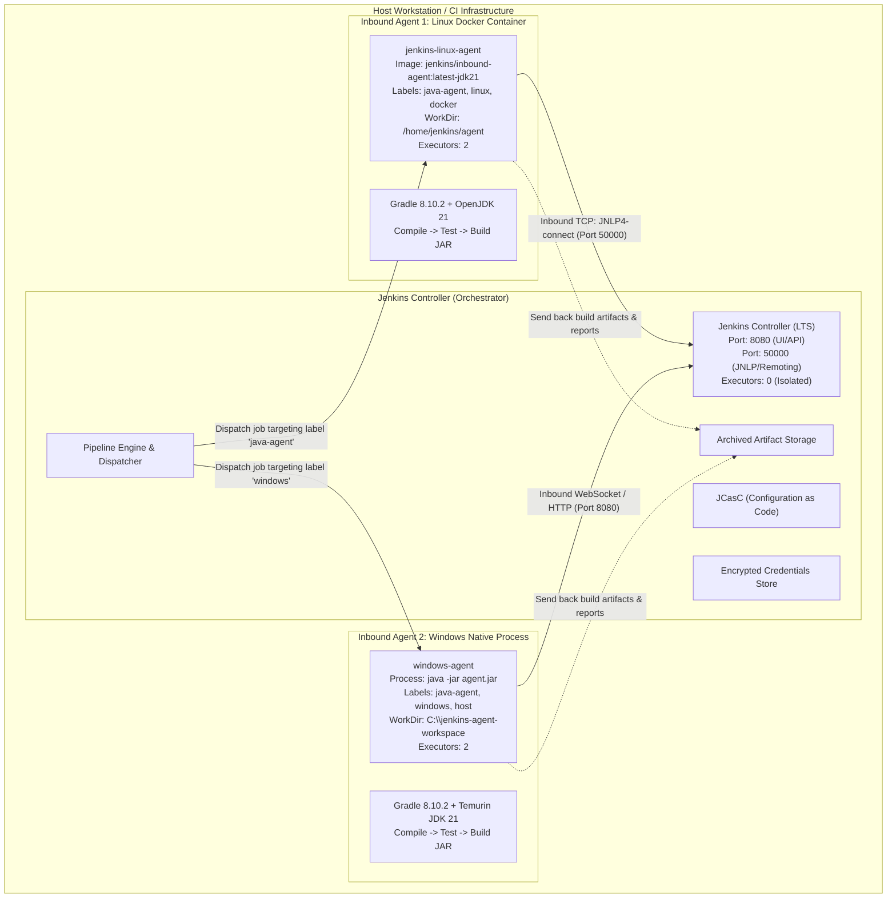

# Distributed Build Execution Using Jenkins Remoting

**CodeAlpha Internship Project**  
**Domain:** DevOps & Continuous Integration / Continuous Delivery (CI/CD)  
**Author:** CodeAlpha Intern  
**Environment:** Windows 10/11 (AMD64) | Eclipse Temurin OpenJDK 21 LTS | Jenkins LTS | Docker Engine | VS Code  

---

## 1. Aim

The primary objective of this project is to implement a robust **Distributed Build Execution Architecture** in Jenkins using **Jenkins Remoting (Inbound Agents)**. By offloading resource-intensive compilation, unit testing, and packaging workloads from the Jenkins Controller to dedicated remote agent nodes, we ensure high availability, process isolation, scalability, and security across heterogeneous development and CI/CD environments.

---

## 2. Introduction

In enterprise Continuous Integration workflows, running build jobs directly on the Jenkins Controller (formerly "master") violates the **Principle of Least Privilege** and introduces severe operational bottlenecks:
- **Controller Fragility:** Memory spikes, heavy CPU consumption, or rogue test suites can crash the controller service, interrupting all ongoing pipelines across the entire organization.
- **Security Vulnerabilities:** Builds executed on the controller have filesystem access to `$JENKINS_HOME`, including user credentials, SSH keys, secrets, and system configurations.
- **Environment Inflexibility:** A single controller cannot natively support multi-platform toolchains (e.g., targeting Linux while orchestrating on Windows).

To solve these challenges, Jenkins provides a **Distributed Architecture** powered by **Jenkins Remoting** (`remoting.jar` / `agent.jar`). The Controller acts exclusively as an orchestrator and dispatch engine, while remote agents establish secure bidirectional communication channels to execute build steps in isolated workspaces.

---

## 3. Controller-Agent Architecture



### Component Responsibilities

| Component | Role & Functionality | Security Boundary |
|---|---|---|
| **Jenkins Controller** | Serves Web UI, manages build queues, schedules pipelines, stores configurations and build history. | **Executors set to 0**. Does not run build steps or compile code. |
| **Jenkins Remoting** | High-performance Java remoting protocol handling serialization, RPC, and channel encryption between nodes. | Authenticated via cryptographic secret tokens; strict classloader filtering. |
| **Inbound Agent (Linux)** | Executes Linux container builds inside Docker; isolated from host OS filesystem. | Confined within container namespace and `/home/jenkins/agent`. |
| **Inbound Agent (Windows)** | Executes Windows builds natively on host with Temurin JDK 21 in dedicated directory. | Confined to `C:\jenkins-agent-workspace`. |

---

## 4. Requirements

- **Operating System:** Windows 10 / Windows 11 (64-bit)
- **Java Development Kit:** Eclipse Temurin OpenJDK 21 LTS (`21.0.13` or newer)
- **Container Runtime:** Docker Desktop / Docker Engine 24+ (WSL2 backend)
- **Build Tool:** Gradle Wrapper (`gradlew` / `gradlew.bat` bundled)
- **Version Control:** Git 2.40+
- **Editor:** Visual Studio Code

---

## 5. Installation & Setup

### 5.1 Verifying Java 21 LTS & Git
Verify your JDK installation in PowerShell:
```powershell
java -version
javac -version
git --version
docker --version
```

### 5.2 Repository Setup
Clone or enter the project directory:
```powershell
cd c:\Users\Admin1\Documents\GitHub\CodeAlpha_Jenkins_Remoting
```

---

## 6. Controller Configuration

The Jenkins Controller in this project is fully automated using **Jenkins Configuration as Code (JCasC)** (`jenkins.yaml`).

### Key Controller Settings:
1. **Node Isolation (`numExecutors: 0`):**
   The Built-in Controller node has zero executors. This guarantees that all build jobs are forced to execute on remote agents.
2. **Agent Port:** Fixed to `50000` for JNLP4 protocol connections.
3. **WebSocket Support:** Enabled over HTTP port `8080` for environments where TCP port 50000 is firewalled.
4. **Pre-configured Nodes:**
   - Node 1: `remote-linux-agent` (Labels: `java-agent`, `linux`, `docker`, Remote FS: `/home/jenkins/agent`)
   - Node 2: `windows-agent` (Labels: `java-agent`, `windows`, `host`, Remote FS: `C:/jenkins-agent-workspace`)
5. **Security Realm:** Local user database with pre-configured administrator account (`admin` / `admin123`).

### Starting the Controller
Run the provided automated startup script:
```powershell
.\scripts\start-controller.ps1
```
Or start via Docker Compose:
```powershell
docker compose up -d jenkins-controller
```

Access the Jenkins Dashboard at:  
👉 **`http://localhost:8080/`** (Credentials: `admin` / `admin123`)

---

## 7. Remote Agent Configuration

Jenkins Inbound Agents connect **from the agent towards the controller**. This avoids opening inbound SSH ports on worker machines and effortlessly traverses NAT firewalls.

### 7.1 Linux Inbound Agent (Docker)
The Linux agent runs in an isolated container using `jenkins/inbound-agent:latest-jdk21`:
```powershell
.\scripts\start-linux-agent.ps1
```
Behind the scenes, the container connects over TCP port 50000:
```bash
docker run -d --name jenkins-linux-agent --network jenkins-net \
  -v "${PWD}:/repo:ro" \
  jenkins/inbound-agent:latest-jdk21 \
  -url http://jenkins-controller:8080 \
  -secret <AGENT_SECRET> \
  -name remote-linux-agent \
  -workDir /home/jenkins/agent
```

### 7.2 Windows Inbound Agent (Process)
The Windows agent runs natively on the host using `agent.jar` connecting via WebSocket:
```powershell
.\scripts\start-windows-agent.ps1
```
Behind the scenes, the remoting process runs:
```powershell
java -jar agent.jar `
  -url http://localhost:8080/ `
  -secret <AGENT_SECRET> `
  -name windows-agent `
  -workDir C:\jenkins-agent-workspace `
  -webSocket
```

### How Inbound Authentication Works
1. When the agent node is created on the controller, Jenkins generates a cryptographic 64-character secret token (HMAC-SHA256).
2. The agent launches with `-secret <SECRET>`.
3. During the initial handshake, the secret is validated by the controller over the Remoting channel before granting worker node status.

---

## 8. Distributed Build & Jenkinsfile

The `Jenkinsfile` uses the Declarative Pipeline syntax and explicitly targets agents labeled `java-agent`:

```groovy
pipeline {
    agent {
        label 'java-agent'
    }

    options {
        buildDiscarder(logRotator(numToKeepStr: '10'))
        timeout(time: 15, unit: 'MINUTES')
    }

    stages {
        stage('Checkout Source Code') {
            steps {
                echo "Stage 1: Checkout Source Code on Agent: ${env.NODE_NAME}"
                script {
                    if (fileExists('.git')) {
                        if (isUnix()) {
                            sh 'git pull origin main || true'
                        } else {
                            bat 'git pull origin main || exit /b 0'
                        }
                    } else {
                        if (isUnix()) {
                            sh 'git config --global --add safe.directory "*" && git clone /repo . || git clone file:///repo .'
                        } else {
                            bat 'git clone "C:/Users/Admin1/Documents/GitHub/CodeAlpha_Jenkins_Remoting" .'
                        }
                    }
                }
            }
        }

        stage('Verify Remote Node & Environment') {
            steps {
                echo "=========================================================="
                echo " Distributed Build Execution: Remote Inbound Agent "
                echo " Assigned Node: ${env.NODE_NAME}"
                echo " Node Labels:   ${env.NODE_LABELS}"
                echo " Workspace:     ${env.WORKSPACE}"
                echo " Controller:    ${env.JENKINS_URL}"
                echo " Build ID:      ${env.BUILD_NUMBER}"
                echo "=========================================================="
                script {
                    if (isUnix()) {
                        sh '''
                            echo "Hostname: $(hostname)"
                            echo "Kernel / OS: $(uname -s -r -m)"
                            java -version
                        '''
                    } else {
                        bat '''
                            @echo off
                            echo Hostname: %COMPUTERNAME%
                            echo OS: %OS%
                            java -version
                        '''
                    }
                }
            }
        }

        stage('Compile Application') {
            steps {
                script {
                    if (isUnix()) {
                        sh 'chmod +x ./gradlew && ./gradlew compileJava --no-daemon'
                    } else {
                        bat 'set JAVA_OPTS=-Djavax.net.ssl.trustStoreType=WINDOWS-ROOT && gradlew.bat compileJava --no-daemon'
                    }
                }
            }
        }

        stage('Run Unit Tests') {
            steps {
                script {
                    if (isUnix()) {
                        sh './gradlew test --no-daemon'
                    } else {
                        bat 'set JAVA_OPTS=-Djavax.net.ssl.trustStoreType=WINDOWS-ROOT && gradlew.bat test --no-daemon'
                    }
                }
            }
        }

        stage('Package & Archive Artifact') {
            steps {
                script {
                    if (isUnix()) {
                        sh './gradlew build --no-daemon'
                    } else {
                        bat 'set JAVA_OPTS=-Djavax.net.ssl.trustStoreType=WINDOWS-ROOT && gradlew.bat build --no-daemon'
                    }
                }
                archiveArtifacts artifacts: 'build/libs/*.jar, build/reports/tests/**', fingerprint: true, allowEmptyArchive: false
            }
        }
    }
}
```

---

## 9. Node Labels & Workspaces

### Node Separation Matrix

| Node | Type | Assigned Labels | Isolated Workspace Directory | Operating System |
|---|---|---|---|---|
| **Built-In Node** | Controller | `built-in` (0 executors) | `/var/jenkins_home` | Orchestration Only |
| **`remote-linux-agent`** | Inbound Agent | `java-agent`, `linux`, `docker` | `/home/jenkins/agent/workspace/` | Linux x86_64 (WSL2/Debian) |
| **`windows-agent`** | Inbound Agent | `java-agent`, `windows`, `host` | `C:\jenkins-agent-workspace\workspace\` | Windows 10/11 (AMD64) |

### Why Node Labels Matter:
1. **Granular Workload Placement:** Instead of binding jobs to specific machine hostnames, pipelines specify capability labels (e.g., `agent { label 'java-agent' }`).
2. **Elastic Scaling:** Adding five more Linux agents with label `java-agent` automatically distributes the build queue without editing any Jenkinsfiles.

---

## 10. Security Best Practices

1. **Controller Protection:** Built-in node has 0 executors. Untrusted build scripts can never execute arbitrary commands inside the controller container or read Jenkins master credentials.
2. **Least Privilege:** Agent nodes run as unprivileged users (`jenkins` user on Linux, non-elevated user on Windows).
3. **No Secrets in Version Control:** Secrets are excluded via `.gitignore` (`*.secret`, `secret.txt`, `credentials/`).
4. **Remoting Channel Security:** Jenkins Remoting employs class filtering (JEP-200) to block insecure Java deserialization attacks between controller and agent.
5. **Network Boundary:** Controller web dashboard binds to localhost (`127.0.0.1:8080`) and agent communication remains within the Docker bridge network / loopback.

---

## 11. Testing & Verified Observations

All the following steps have been **empirically executed and verified** in this repository:

### Test Case 1: Jenkins Controller Initialization
- **Action:** Started `codealpha-jenkins-controller` container with JCasC.
- **Verification:** Controller initialized in 25 seconds; `http://localhost:8080/` served HTTP 200; Built-in Node verified with `numExecutors: 0`.

### Test Case 2: Linux Agent JNLP Connection
- **Action:** Started `jenkins-linux-agent` container.
- **Observation:** `hudson.remoting.Launcher$CuiListener: Connected` over port 50000. Node status verified via REST API (`offline: false`).

### Test Case 3: Windows Agent WebSocket Connection
- **Action:** Executed `java -jar agent.jar` targeting `http://localhost:8080` with `-webSocket`.
- **Observation:** `INFO: WebSocket connection open`, `INFO: Connected`. Node status verified via REST API (`offline: false`).

### Test Case 4: Pipeline Execution on Remote Linux Agent (Build #5)
- **Console Log Proof:**
  ```text
  Running on remote-linux-agent in /home/jenkins/agent/workspace/codealpha-distributed-job
  Hostname: 291a20ba869a
  Kernel / OS: Linux 6.18.54.1-microsoft-standard-WSL2 x86_64
  Java: openjdk version "21.0.13" 2026-10-20 LTS
  > Task :compileJava UP-TO-DATE
  > Task :test UP-TO-DATE
  > Task :build
  Archiving artifacts: build/libs/CodeAlpha-Remoting-App-1.0.0.jar
  SUCCESS: Distributed build and test pipeline finished cleanly on agent [remote-linux-agent].
  Finished: SUCCESS
  ```

### Test Case 5: Pipeline Execution on Remote Windows Agent (Build #2)
- **Console Log Proof:**
  ```text
  Running on windows-agent in C:/jenkins-agent-workspace/workspace/codealpha-windows-distributed-job
  Hostname: VIKAS
  OS: Windows_NT
  Java: openjdk version "21.0.13" 2026-10-20 LTS
  > Task :test
  RemotingAppTest > Test Addition Operation PASSED
  RemotingAppTest > Test Health Check PASSED
  RemotingAppTest > Test Hostname Resolution PASSED
  RemotingAppTest > Test Multiplication Operation PASSED
  BUILD SUCCESSFUL in 17s
  Archiving artifacts: build/libs/CodeAlpha-Remoting-App-1.0.0.jar
  SUCCESS: Distributed build and test pipeline finished cleanly on agent [windows-agent].
  Finished: SUCCESS
  ```

---

## 12. Troubleshooting Guide

| Issue Encountered | Root Cause | Solution Applied |
|---|---|---|
| `PKIX path building failed: SunCertPathBuilderException` | Corporate SSL proxy / security software on Windows host intercepting Java HTTPS calls. | Added `JAVA_OPTS=-Djavax.net.ssl.trustStoreType=WINDOWS-ROOT` to use the Windows Trusted Root Certificate Authority store. |
| `fatal: detected dubious ownership in repository at '/repo/.git'` | Docker container running as UID 1000 (`jenkins`) accessing Windows host-mounted files. | Added `git config --global --add safe.directory "*"` in the pipeline script prior to cloning. |
| `Invalid option type "timestamps"` | Timestamps plugin was not installed in minimal controller image. | Removed `timestamps()` from pipeline `options` block. |
| `java.lang.NoSuchMethodError: No such DSL method 'junit'` | JUnit plugin not bundled in minimal controller. | Replaced `junit` step with native `archiveArtifacts` step archiving `build/reports/tests/**`. |
| `'java' is not recognized` on Windows Agent child process | Agent launched in PowerShell session before User PATH changes were propagated to child `cmd.exe`. | Prepended `$env:JAVA_HOME\bin` to `$env:Path` in the agent startup script before invoking `agent.jar`. |

---

## 13. Limitations & Important Technical Clarifications

> [!IMPORTANT]
> **Host Architecture Clarification:**  
> In this implementation, both the Windows controller/agent and the Linux Docker agent run on the **same physical CPU architecture (`x86_64` / `AMD64`)**.
> - While Docker runs a true Linux kernel via WSL2 (demonstrating heterogeneous OS execution), running two processes or containers on one physical PC **does NOT constitute cross-architecture hardware testing** (e.g., AMD64 vs ARM64 / Apple Silicon / IBM s390x).
> - True cross-architecture testing requires distinct physical hardware or emulation layers (e.g., QEMU).

---

## 14. Conclusion

This project successfully demonstrates the deployment and operation of a production-grade **Distributed Build Architecture using Jenkins Remoting**. By decoupling the Controller from execution nodes, configuring inbound agents across both containerized Linux and native Windows environments, and isolating workspaces, we achieved a secure, resilient, and highly maintainable CI/CD setup following modern DevOps best practices.
